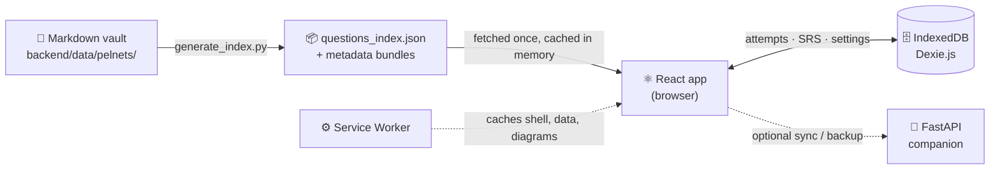

<div align="center">


# SLACKR

**The offline-first PhilNITS exam reviewer.**
<br/>
*Study smarter, slack less. Your koala companion for the FE exam.*

<br/>


<br/>


<br/>

**3,609 questions** · **2007 → 2026** · **2,400+ diagrams** · **29 topics** · **3 SRS algorithms** · **0 servers required**

<br/>

[Features](#-features) ·
[How to Use](#-how-to-use) ·
[Getting Started](#-getting-started) ·
[Architecture](#-architecture) ·
[Development](#-development)

</div>

---

## 🐨 What is SLACKR?

SLACKR is a study platform for the **Philippine National IT Standards (PhilNITS)** Fundamental IT Engineer exam — both **FE-A (AM)** and **FE-B (PM)** papers. Every past question from 2007 to 2026 is compiled into a single static bundle, so once the app is loaded it runs **entirely in your browser** — no account, no server, no internet.

Your attempts, review schedules and settings live in your device's IndexedDB. Install it as an app, download everything once, and study on a plane, in a jeepney, or in a dead-zone library.

<div align="center">

</div>

---

## ✨ Features

<table>
<tr>
<td width="50%" valign="top">

### 📚 Complete Question Vault
All **3,609** PhilNITS FE questions from **2007–2026**, sorted the way the exam is: year → season (Spring before Autumn) → paper (FE-A before FE-B) → question number.

### 🧠 Spaced Repetition, Your Way
Pick between **SuperMemo SM-2**, **FSRS**, or **SLACKR Custom** (which factors in topic weakness, response time and confidence). Switch any time — your history is replayed under the new algorithm.

### 🎯 Confidence Calibration
Rate how sure you are **before** the answer is revealed. SLACKR charts where you're overconfident and where you're underselling yourself.

</td>
<td width="50%" valign="top">

### 📊 Weakness Heatmap & Analytics
Error rates across all **29 official topic categories**, grouped by day, week or month, plus an FE-A / FE-B analytics matrix and per-topic breakdowns.

### 📴 Truly Offline (PWA)
Install on desktop or phone. One tap downloads the full question bank, all 2,400+ diagrams, and fonts into the cache.

### 🔍 Built for Reading Diagrams
KaTeX math rendering (`$inline$` / `$$display$$`), and diagrams you can pinch-zoom on touch screens or zoom with the keyboard.

### 💾 Your Data, Portable
Export your entire progress to a JSON file and import it on another device — merge or replace.

</td>
</tr>
</table>

---

## 🚀 How to Use

### 1. Pick a way to practice

| Mode | Where | Best for |
| :--- | :--- | :--- |
| 🗓️ **Year Papers** | `/quiz/year` | Full mock exams — take a whole season's paper like the real thing |
| 🗂️ **Topics** | `/quiz/topic` | Drilling one weak area (Networking, Security, Algorithms, …) |
| 🔀 **Combined** | `/quiz/combined` | Narrow focus — e.g. *Databases* questions from *2015–2020* only |
| 🛠️ **Custom Builder** | `/quiz/custom` | Hand-picked sets, filtered by answered / unanswered, saved for reuse |
| 🔁 **SRS Queue** | `/quiz/srs` | Your daily review — questions the algorithm says are due today |

### 2. Answer a question

1. Read the question (tap any diagram to zoom in).
2. Choose an answer — click it, or press **`A`–`F`** / **`1`–`4`**.
3. Set your **confidence** (1–5) — be honest, this powers calibration.
4. Press **`Enter`** to submit.
5. Read the explanation, then press **`Space`** or **`Enter`** for the next question.

Every answer is recorded and scheduled for review automatically.

### 3. Come back daily

Open the **SRS Queue** each day — the badge in the top bar shows how many reviews are due. Short daily sessions beat long cramming sessions.

### 4. Find your weak spots

Head to **Analytics** to see your heatmap, accuracy by topic, FE-A vs FE-B performance, and calibration curve. Click into any question's history from there.

### 5. Make it work offline

1. Open SLACKR in Chrome, Edge, or Safari.
2. Install it — use your browser's **Install app** option (or *Share → Add to Home Screen* on iOS).
3. Go to **Settings → Offline Download** and start the download.
4. Once it finishes, SLACKR works 100% offline — airplane mode included.

### 6. Back up your progress

**Settings → Data Backup & Portability** → **Export** downloads a JSON snapshot of everything. On another device, **Import** it and choose **Merge** (combine histories) or **Replace** (overwrite).

### ⌨️ Keyboard Shortcuts

| Key | Action |
| :---: | :--- |
| `A`–`F` · `1`–`4` | Select an answer |
| `Enter` | Submit answer |
| `Space` / `Enter` | Next question (after answering) |
| `+` / `-` / `0` | Zoom in / out / reset an open diagram |
| `Esc` | Close diagram viewer |

---

## 🏁 Getting Started

### Prerequisites

- [Bun](https://bun.sh) — frontend tooling
- [Python 3.10+](https://www.python.org/) — only needed to rebuild the question index or run the optional API

### Run the app

```powershell
git clone https://github.com/Tech-Wrightttt/Slackr.git
cd Slackr/frontend
bun install
bun run dev
```

Open **[http://localhost:5173](http://localhost:5173)** and start studying. That's it — the compiled question data already ships in `frontend/public/data/`.

### Production build

```powershell
bun run build      # → frontend/dist/
bun run preview    # serve the build locally
```

### Optional: backend setup

You only need this to recompile the question vault or run the companion sync API.

```powershell
# From the repository root
python -m venv backend\venv
backend\venv\Scripts\pip.exe install -r backend\requirements.txt

# Recompile the Markdown vault → frontend/public/data/questions_index.json
backend\venv\Scripts\python.exe backend/scripts/generate_index.py

# Companion API at http://127.0.0.1:8000 (optional — the app works without it)
backend\venv\Scripts\python.exe -m uvicorn main:app --app-dir backend --host 127.0.0.1 --port 8000 --reload
```

---

## 🏗️ Architecture



- **Source of truth** — an Obsidian-flavored Markdown vault of PhilNITS questions.
- **Compile step** — `generate_index.py` parses the vault into static JSON bundles.
- **Runtime** — the frontend loads the bundle once and never needs the network again for questions.
- **Progress** — attempts, SRS schedules, topic stats and sessions are stored locally in IndexedDB.
- **Sync** — the FastAPI backend mirrors the client logic for cross-device backup; it is entirely optional.

<details>
<summary><b>📁 Project structure</b></summary>

```
Slackr/
├── backend/
│   ├── algorithms/          # SM-2, FSRS, Custom SRS (Python reference impls)
│   ├── data/pelnets/        # Markdown question vault + diagram files
│   ├── models/schemas.py    # Pydantic models
│   ├── parsers/             # Markdown + WikiLink parser
│   ├── scripts/             # generate_index.py (vault compiler)
│   ├── services/            # Stats + analytics services
│   ├── tests/               # Backend test suite
│   └── main.py              # FastAPI companion API
│
└── frontend/
    ├── public/
    │   ├── data/            # Offline JSON bundles
    │   ├── files/           # Exam diagrams
    │   ├── icons/           # PWA + favicon icons
    │   ├── manifest.json    # Web App Manifest
    │   └── sw.js            # Service Worker
    └── src/
        ├── components/      # QuestionCard, AnswerFeedback, MarkdownRenderer, ZoomableImage…
        ├── db/              # Dexie schema
        ├── pages/           # Home, Quiz modes, Analytics, History, Settings
        ├── services/        # questions, srsEngine, analytics, sync, offline
        └── store/           # Zustand UI state
```

</details>

<details>
<summary><b>🆔 Question ID format</b></summary>

Question IDs follow `{YEAR}{SEASON}_FE_{PAPER}_{NUMBER}` — for example `2024S_FE_AM_Q15`.
PM questions from 2008 onward have sub-questions: `2008A_FE_PM_Q1_SQ1`.

</details>

---

## 🧪 Development

```powershell
# Backend tests: parser, SM-2, FSRS, Custom SRS, analytics, replay, API endpoints
backend\venv\Scripts\python.exe backend/tests/test_backend.py
```

After editing anything in the Markdown vault, re-run `generate_index.py` so the frontend bundles stay in sync.

---

<div align="center">


**Made with 🍃 for every PhilNITS examinee.**

*Questions sourced from past PhilNITS FE examinations.*

</div>
