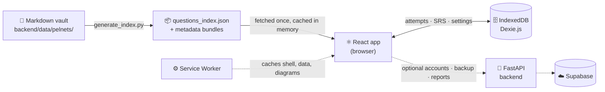

<div align="center">

<a href="https://slackr-seven.vercel.app/">
  <picture>
    <source media="(prefers-color-scheme: dark)" srcset="frontend/public/brand/logo-dark.png" />
    
  </picture>
</a>

### The offline-first PhilNITS exam reviewer

*Study smarter, slack less. Your koala companion for the FE exam.*

<br/>

<a href="https://slackr-seven.vercel.app/">
  
</a>

<br/><br/>


<br/>


<br/>


<br/>

**3,609 questions** · **2007 → 2026** · **2,400+ diagrams** · **29 topics** · **3 SRS algorithms** · **works 100% offline**

<br/>

[**Live App**](https://slackr-seven.vercel.app/) ·
[Features](#-features) ·
[How to Use](#-how-to-use) ·
[Getting Started](#-getting-started) ·
[Architecture](#%EF%B8%8F-architecture) ·
[Development](#-development)

</div>

---

## 🐨 What is SLACKR?

SLACKR is a study platform for the **Philippine National IT Standards (PhilNITS)** Fundamental IT Engineer exam, covering both **FE-A (AM)** and **FE-B (PM)** papers. Every past question from 2007 to 2026 ships in a single static bundle, so once the app is loaded it runs **entirely in your browser**.

Your attempts, review schedules and settings live in your device's IndexedDB. Install it as an app, download everything once, and study on a plane, in a jeepney, or in a dead-zone library. Want your progress on more than one device? Create an optional online account and back it up to the cloud.

> **👉 Try it now at [slackr-seven.vercel.app](https://slackr-seven.vercel.app/)**. No install required, no account required.

<div align="center">

</div>

---

## ✨ Features

<table>
<tr>
<td width="50%" valign="top">

### 📚 Complete Question Vault
All **3,609** PhilNITS FE questions from **2007–2026**, sorted the way the exam is: year, season (Spring before Autumn), paper (FE-A before FE-B), then question number.

### 🧠 Spaced Repetition, Your Way
Pick **SuperMemo SM-2**, **FSRS**, or **SLACKR Custom** (which weighs topic weakness, response time and confidence). Switch any time; your history is replayed under the new algorithm.

### 📅 Daily Set & Activity Tracker
A fresh **Daily Set** every day that resumes where you left off, an activity calendar of your study streak, and **Priority Weak Spots** on the home page.

### 🎯 Confidence Calibration
Rate how sure you are **before** the answer is revealed. SLACKR charts where you are overconfident and where you undersell yourself.

### ✏️ Draw on Any Question
A full-screen **draw overlay** for scratch work: trace diagrams, work out binary math or sketch flowcharts right on top of the question. Press `Esc` to exit.

### 🔖 Bookmarks & Deferred Questions
Bookmark questions to revisit, defer ones you want to skip for now, and see both highlighted in the Question Grid.

</td>
<td width="50%" valign="top">

### 📊 Weakness Heatmap & Analytics
Error rates across all **29 official topic categories** by day, week or month, an FE-A / FE-B analytics matrix, color-coded topics and per-question history.

### ☁️ Optional Online Accounts
Sign up to **back up your progress to the cloud** and **sign in on any device**. Keep **several accounts on one device**, reset a forgotten password, and keep using guest mode whenever you like.

### 📴 Truly Offline (PWA)
Install on desktop or phone. One tap downloads the full question bank, every diagram and the fonts into the cache.

### 🔍 Built for Reading Diagrams
KaTeX math rendering (`$inline$` / `$$display$$`) and diagrams you can pinch-zoom on touch screens or zoom with the keyboard.

### 🐞 Bug Reports, Even Offline
Spot a wrong answer or a confusing explanation? Tap the bug icon to report the question, the explanation or the app. Reports queue offline and send when you reconnect.

### 💾 Your Data, Portable
Export everything to JSON and import it on another device (merge or overwrite). You can also **import progress from PelNETS** into your history, bookmarks and deferred list.

### 📰 What's New
A **News** tab shows the app version and what each release brings.

</td>
</tr>
</table>

---

## 🚀 How to Use

### 1. Open the app

Go to **[slackr-seven.vercel.app](https://slackr-seven.vercel.app/)**. Continue as a guest, or sign up for an online account if you want cloud backup.

### 2. Pick a way to practice

| Mode | Where | Best for |
| :--- | :--- | :--- |
| 📅 **Daily Set** | Home page | A short, fresh set of questions every day |
| 🗓️ **Year Papers** | `/quiz/year` | Full mock exams: take a whole season's paper like the real thing |
| 🗂️ **Topics** | `/quiz/topic` | Drilling one weak area (Networking, Security, Algorithms, …) |
| 🔀 **Combined** | `/quiz/combined` | Narrow focus, e.g. *Databases* questions from *2015–2020* only |
| 🛠️ **Custom Builder** | `/quiz/custom` | Hand-picked sets filtered by answered, unanswered or bookmarked, saved for reuse |
| 🔁 **SRS Queue** | `/quiz/srs` | Your daily review: questions the algorithm says are due today |

### 3. Answer a question

1. Read the question. Tap any diagram to zoom in, or open the draw overlay for scratch work.
2. Choose an answer: click it, or press **`A`–`F`** / **`1`–`4`**.
3. Set your **confidence** (1–5). Be honest; this powers calibration.
4. Press **`Enter`** to submit.
5. Read the explanation, then press **`Space`** or **`Enter`** for the next question.

Every answer is recorded and scheduled for review automatically.

### 4. Come back daily

Open the **Daily Set** and the **SRS Queue** each day. The badge in the top bar shows how many reviews are due. Short daily sessions beat long cramming sessions.

### 5. Find your weak spots

Open **Analytics** for your heatmap, accuracy by topic, FE-A vs FE-B performance and calibration curve. Click into any question's history from there.

### 6. Make it work offline

1. Open SLACKR in Chrome, Edge or Safari.
2. Install it with the **Install** button in the top bar, your browser's **Install app** option, or *Share → Add to Home Screen* on iOS.
3. Start the **Offline Download** (top bar or **Profile → Offline Download**).
4. Once it finishes, SLACKR works 100% offline, airplane mode included.

### 7. Keep your progress safe

- **Cloud backup:** sign in from **Profile** and your progress backs up to your online account. Sign in on another device to pull it down.
- **Manual backup:** **Profile → Export JSON Archive** downloads a snapshot. On another device, **Import JSON Archive** and choose **Merge with existing** or **Overwrite database**.
- **Coming from PelNETS?** Use **Import from PelNETS** to bring your attempts, bookmarks and deferred questions over.

### ⌨️ Keyboard Shortcuts

| Key | Action |
| :---: | :--- |
| `A`–`F` · `1`–`4` | Select an answer |
| `Enter` | Submit answer |
| `Space` / `Enter` | Next question (after answering) |
| `+` / `-` / `0` | Zoom in / out / reset an open diagram |
| `Esc` | Close the diagram viewer or the draw overlay |

---

## 🏁 Getting Started

### Prerequisites

- [Bun](https://bun.sh) for the frontend
- [Python 3.10+](https://www.python.org/), only to rebuild the question index or run the optional API

### Run the app locally

```powershell
git clone --recurse-submodules https://github.com/Tech-Wrightttt/Slackr.git
cd Slackr/frontend
bun install
bun run dev
```

Open **[http://localhost:5173](http://localhost:5173)** and start studying. The compiled question data already ships in `frontend/public/data/`.

### Production build

```powershell
bun run build      # → frontend/dist/
bun run preview    # serve the build locally
```

### Optional: backend setup

You only need this to recompile the question vault or run the accounts / backup / reports API.

```powershell
# From the repository root
python -m venv backend\venv
backend\venv\Scripts\pip.exe install -r backend\requirements.txt

# Recompile the Markdown vault → frontend/public/data/questions_index.json
backend\venv\Scripts\python.exe backend/scripts/generate_index.py

# Companion API at http://127.0.0.1:8000 (optional: the app works without it)
backend\venv\Scripts\python.exe -m uvicorn main:app --app-dir backend --host 127.0.0.1 --port 8000 --reload
```

Online accounts need `SUPABASE_URL` and `SUPABASE_ANON_KEY` in `backend/.env`. See [`SUPABASE_VERCEL_DEPLOYMENT.md`](SUPABASE_VERCEL_DEPLOYMENT.md) for the full Supabase + Vercel setup.

---

## 🏗️ Architecture



- **Source of truth:** an Obsidian-flavored Markdown vault of PhilNITS questions ([PelNETS](https://github.com/Joryuoo/pelnets), included as a git submodule).
- **Compile step:** `generate_index.py` parses the vault into static JSON bundles.
- **Runtime:** the frontend loads the bundle once and never needs the network again for questions.
- **Progress:** attempts, SRS schedules, topic stats and sessions live in IndexedDB, one database per device profile.
- **Accounts & backup:** the FastAPI backend owns sign-up, sign-in, cloud backup and bug reports. It is the only code that talks to Supabase; the browser never does. Everything else works without it.

<details>
<summary><b>📁 Project structure</b></summary>

```
Slackr/
├── backend/
│   ├── algorithms/          # SM-2, FSRS, Custom SRS (Python reference impls)
│   ├── data/pelnets/        # Markdown question vault (git submodule)
│   ├── models/schemas.py    # Pydantic models
│   ├── parsers/             # Markdown + WikiLink parser
│   ├── routers/account.py   # Accounts, cloud backup and reports API
│   ├── scripts/             # generate_index.py (vault compiler)
│   ├── services/            # Stats, analytics, Supabase gateway
│   ├── tests/               # Backend test suite
│   └── main.py              # FastAPI app
│
├── supabase/migrations/     # Database schema
│
└── frontend/
    ├── public/
    │   ├── brand/           # Light / dark logos
    │   ├── data/            # Offline JSON bundles
    │   ├── files/           # Exam diagrams
    │   ├── icons/           # PWA + favicon icons
    │   ├── manifest.json    # Web App Manifest
    │   └── sw.js            # Service Worker
    └── src/
        ├── components/      # QuestionCard, DrawOverlay, DailySetModal, ReportDialog, ZoomableImage…
        ├── data/            # Release notes for the News tab
        ├── db/              # Dexie schema
        ├── pages/           # Home, Quiz modes, Analytics, History, Profile, News, Auth
        ├── services/        # questions, srsEngine, analytics, sync, offline
        └── store/           # Zustand UI state
```

</details>

<details>
<summary><b>🆔 Question ID format</b></summary>

Question IDs follow `{YEAR}{SEASON}_FE_{PAPER}_{NUMBER}`, for example `2024S_FE_AM_Q15`.
PM questions from 2008 onward have sub-questions: `2008A_FE_PM_Q1_SQ1`.

</details>

---

## 🧪 Development

```powershell
# Backend tests: parser, SM-2, FSRS, Custom SRS, analytics, replay, API endpoints
backend\venv\Scripts\python.exe backend/tests/test_backend.py
```

After the PelNETS vault changes, update the submodule and recompile the bundles:

```powershell
git -C backend/data/pelnets pull
backend\venv\Scripts\python.exe backend/scripts/generate_index.py
```

Then commit both the submodule pointer and the regenerated JSON.

---

<div align="center">

<a href="https://slackr-seven.vercel.app/">
  
</a>

**[slackr-seven.vercel.app](https://slackr-seven.vercel.app/)**

**Made with 🍃 for every PhilNITS examinee.**

*Questions sourced from past PhilNITS FE examinations via [PelNETS](https://github.com/Joryuoo/pelnets).*

</div>
